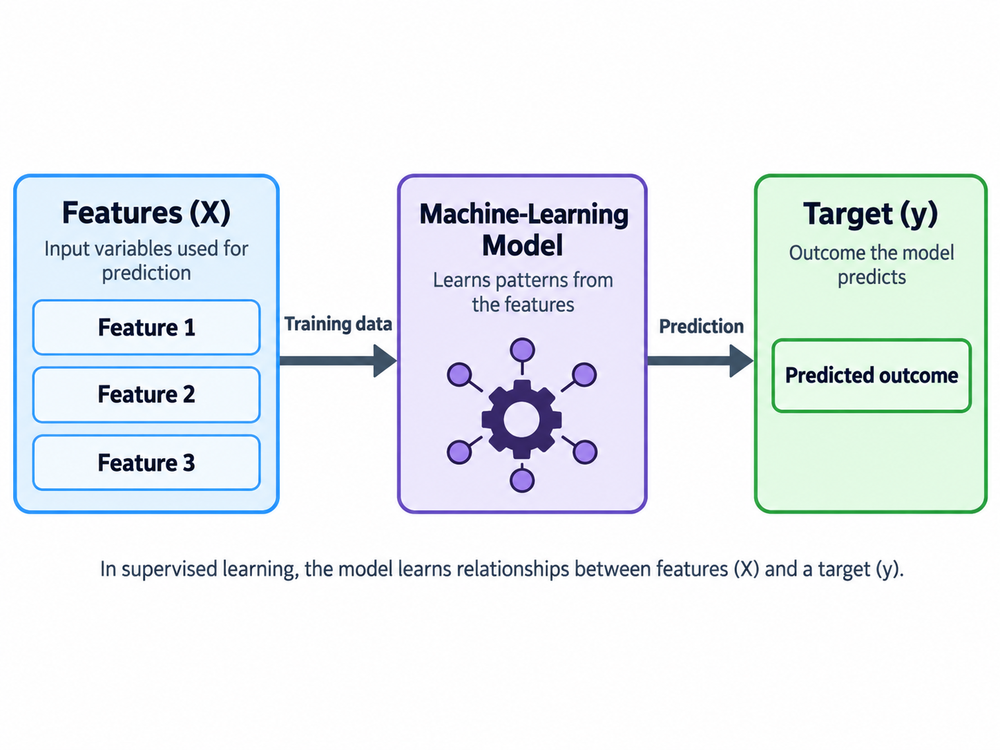

## 1. What Are Features and Targets and why does it matter?

When training a model in machine learning, we need to answer two important questions:

1.  **What information should the model use to make predictions?**
2.  **What are we trying to predict?**

These questions introduce two fundamental concepts in supervised machine learning: **features** and **targets**.

In this tutorial, we will learn how to identify features and targets, separate them using Python's pandas library, and avoid common mistakes when choosing variables for a prediction problem.

In machine learning, a model learns patterns from data containing input variables and known outcomes.

- **Features**: input variables which a model uses to make predictions. They provide information that could help explain and predict an outcome. It id also called predictors.

- **Target**: variable which we want the model to predict. It is also called the response variable or dependent variable.

We can describe this relationship using linear model:

$Y_i=\beta_0+\beta_1X_{i1}+\beta_2X_{i2}+\beta_3X_{i3}+\varepsilon_i$

In machine learning, features are represented by `X`, and the target is represented by Y. {#fig-ml-flow}

An important distinction is that **a variable is not automatically a feature or target based on its name or data type. Its role depends on the prediction question.**

Features give the algorithm the patterns it uses to map input data to the target outcome, and the target shows what problem we are solving and whether the task is classification or regression. Reasonable features lead to high accuracy, and it is important to avoid overfitting.

## 2. Identifying Features and Targets in a Real-World Dataset

Now that we understand the concepts of features and targets, let's apply them to a real-world dataset.

We will use the [House Prices — Advanced Regression Techniques dataset](https://www.kaggle.com/competitions/house-prices-advanced-regression-techniques/data) from Kaggle.

Our prediction question is:

**Can we predict a house's selling price based on its characteristics?**

First, let's load the dataset using Python and pandas.

```{python}
import pandas as pd

houses = pd.read_csv("data/train.csv")

print(houses.shape)
houses.head()
```

The dataset has 1,460 rows and 81 columns. Each row represents a house, while each column represents a variable describing that house.

Let's consider our house-price example.

My question is:

**What effects the house price example?**

To build a model to answer this question, we have to find:

**What information should the model use to make predictions?**

These are some variables I found potentially relevant to the house price such as YearRemodAdd, Neighborhood, and GrLivArea. We are trying to see if these contribute to the SalePrice. Therefore, we can set these three variables as the features.

| Variable | Description |
|----------------------------|--------------------------------------------|
| `YearRemodAdd` | Remodel date (same as construction date if no remodeling or additions) |
| `Neighborhood` | Physical locations within Ames city limits |
| `GrLivArea` | Above grade (ground) living area square feet |

: These features provide information about each house's remodeling date, location, and the above grade, while the target represents the outcome we want to predict, which is the price of a house.

For this tutorial, we will focus on four variables, including the three features (YearRemodAdd, Neighborhood, GrLivArea) and the target(SalePrice):

| Variable | Description | Role |
|--------------------|------------------------------|----------------------|
| `YearRemodAdd` | Year of remodeling, or construction if never remodeled | Feature |
| `Neighborhood` | Physical location within Ames | Feature |
| `GrLivArea` | Above-ground living area in square feet | Feature |
| `SalePrice` | Selling price of the house | Target |

Let's filter the variables and save it into `data_for_model.`

```{python}
data_for_model = houses.loc[:,["YearRemodAdd", "Neighborhood", "GrLivArea", "SalePrice"]]
data_for_model.head()
```

## 3. Separating Features and Targets with pandas

Once we've identified our features and target, let's separate them into different variables using pandas.

In machine learning, we commonly use `X` to represent the features and `Y` to represent the target.

```{python}
X = data_for_model.loc[:,["YearRemodAdd", "Neighborhood", "GrLivArea"]]
Y = data_for_model.loc[:,"SalePrice"]
```

Let's break down this code.

**`X` contains our features.**

The result is another DataFrame containing only our three selected features.

```{python}
X.head()
```

**`Y` contains our target.**

We select the `SalePrice` column as a Series.

```{python}
Y.head()
```

We can also check the dimensions of our features and target.

```{python}
print("Features:", X.shape)
print("Target:", Y.shape)
```

This tells us that `X` contains 1,460 observations and three features, while `Y` contains 1,460 target values.

### Why Do We Separate X and Y?

Many machine-learning tools expect the features and target to be provided separately.

For example, a typical model in scikit-learn is trained using the following structure:

``` python
model.fit(X, Y)
```

Here, `X` contains the information used to learn patterns, while `Y` provides the known outcomes.

Furthermore, to train the model, our categorical feature `Neighborhood` would need to be encoded for many machine-learning algorithms.

The main takeaway is that separating `X` and `Y` is an essential preparation step before training a supervised machine-learning model.

## 4. Choosing the Right Features

Identifying the target is usually straightforward once we know our prediction question. However, choosing appropriate features requires more consideration.

Let's look at three important questions to ask when selecting features.

### Does the Variable Contain Potentially Useful Information?

For our housing dataset, `GrLivArea` could be a useful feature because houses at higher level may tend to have higher selling prices.

Similarly, `Neighborhood` could provide useful information because house prices often vary depending on location. For example, houses in safe area with low-crime rate could be more expensive than houses in an area with high-crime rate.

When choosing features, we should consider whether each variable could help explain or predict the target.

### Will This Information Be Available When Making Predictions?

Suppose we want to predict a house's selling price before it is sold.

We can use information such as its living area, neighborhood, and remodeling year because these characteristics can be known before the sale.

However, we cannot use the final selling price itself as a feature because that information would not yet be available.

Using information that would not be available at prediction time can cause **data leakage**.

Data leakage occurs when information that should not be available to a model is used during training or evaluation. This can make the model appear more accurate than it would be when making predictions on new data.

## Conclusion

Understanding the difference between features and targets is an essential first step in building a supervised machine-learning model.

Remember:

- **Features (X)** are the input variables used to make predictions.
- **The target (Y)** is the outcome we want the model to predict.
- A variable's role depends on the prediction question.
- Features can be numerical or categorical.
- Not every available variable should automatically be included as a feature.

**Your next step:** Find another dataset on [Kaggle](https://www.kaggle.com/datasets), define your own prediction question, and use pandas to separate the features and target into `X` and `Y`.

Before building a model, ask yourself the two questions:

*What am I trying to predict, and what information do I need to make a successful prediction?*

Answering these questions will help you choose appropriate features and targets before moving on to model training.